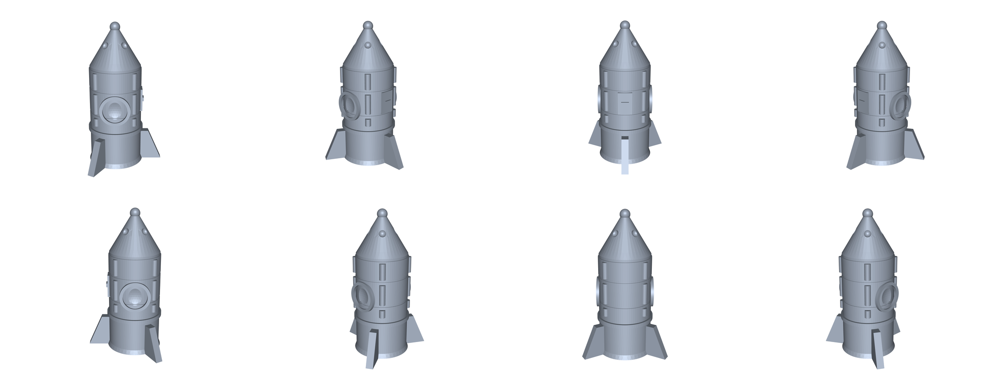

# cad-sample-models

可 3D 打印的小玩具 + 样例零件。所有模型由 CadQuery（OpenCascade 内核）参数化生成。

## 预览

| 齿轮陀螺（顶） | 齿轮陀螺（底 / 锥尖） |
|---|---|
|  |  |

| 指尖陀螺 | 小火箭 v15 |
|---|---|
|  |  |

## 一、3D 打印小玩具（2026-10）

| 文件 | 尺寸 (mm) | 实体体积 | 预估打印\* | 说明 |
|---|---|---|---|---|
| \`toys/gear_top.stl\` | 38 × 38 × 26 | 10 208 mm³ | ~12 min | 齿轮外缘陀螺，锥尖朝下打印 |
| \`toys/fidget_spinner.stl\` | 66 × 60 × 7 | 8 445 mm³ | ~13 min | 三叶指尖陀螺，中心 608 轴承孔 Ø22.2 |
| \`toys/rocket.stl\` | 29.4 × 33.3 × 55.8 | 5 371 mm³ | ~17 min | 战术风中空小火箭，13 个建模阶段 |
| \`toys/gear_a.stl\` | 44 × 44 × 8 | 9 497 mm³ | ~12 min | 20 齿主动齿轮，m=2，Ø7 轴孔 |
| \`toys/gear_b.stl\` | 24 × 23 × 8 | 2 074 mm³ | ~4 min | 10 齿从动齿轮，中心距 30 mm |

\* 预估基于 0.4 mm 喷嘴 / 0.2 mm 层高 / 20% 填充 / 约 7 mm³/s 有效挤出速率，实际以切片软件为准。

### 打印建议

- STL 单位是毫米，导入切片软件不要缩放。
- **齿轮陀螺**：锥尖朝下直接打，锥面约 40° 悬垂，一般无需支撑；底面加 3–5 mm brim 更稳。
- **火箭**：竖直打印。内腔从底部喷口贯通到顶部，属内部空心结构，切片时开"检测薄壁"会更保险。
- **齿轮对**：两件分开打，中心距 30 mm 装底板即可啮合。
- **指尖陀螺**：三叶配重孔可塞 M8 螺母，或直接实心打配重。

### 齿轮参数（可复现）

齿廓为标准渐开线（压力角 20°，齿顶高系数 1.0，齿根高系数 1.25）。
生成器 \`gearlib.py\` 在私有仓库 agentSpace 的 \`_cad/scripts/\` 下。

## 二、火箭 v15 减料与薄壁修复（2026-10-30）

v14 解决了「空层 / 窗悬空」，但实测仍有 0.4–0.5 mm 的薄壁，且预估 19 min 超出 17 min 目标。
v15 逐 stage 拆体积、射线法量壁厚，定位到四个结构问题，全部已修：

| # | 问题 | 真因 | 修法 |
|---|---|---|---|
| 1 | 头锥环槽切穿 | 切刀是圆柱、头锥是锥面，槽底半径在锥身上段已大于锥面半径 | 整道删掉（沿锥面斜切才安全，视觉收益不值） |
| 2 | 4 个姿控喷口看不见 | 圆柱凹槽起点在锥面内侧 0.6，再向内 0.9，整根埋在壁里 | 改成外切球冠坑 R1.6 @ rr+0.9，开口 Ø2.6、坑深 0.7 |
| 3 | 舷窗残留壁 0.48 mm | R7.6 球坑最深 9.6，内腔 9.1，只剩 0.5 mm | 改 R9.0 @ y=±18.8，坑深 0.7、残留 0.70 mm |
| 4 | 检修口把壁削到 0.4 mm | 凹槽深 5.6 直接切穿 1.4 mm 筒壁 | 改成外凸盖板（union 不 cut）+ 把手，零切壁风险 |

减料与加粗：

- 底板 3.0 → 2.4 mm；头锥内腔提前结束（原来锥面收得比内腔快，壁厚一路减到 0.2）
- 分界槽深 0.9 → 0.6；主环槽深 0.45；纵筋 R0.9 → R1.15（外露 0.85）
- 删除顶针（Ø1.1 × 4 竖杆，打印必断）
- 尾翼总厚 2.8、外伸 8.5，整体缩放 0.97

修复后自检：

- 体积 5 371.5 mm³（网格实测 5 368.8），预估 **17.0 min**
- 单实体、单壳体、\`watertight = True\`、边界边 0
- 沿 Z 每 0.1 mm 切一层共 557 层，**异常层 0**
- 射线法壁厚 2 485 个采样：p01 = 1.07、p05 = 1.16、中位 2.71 mm；< 0.80 mm 仅 6 个点（0.24%），其中 5 个是舷窗设计值 0.70–0.79

## 三、CATIA 验证零件

| 文件 | 协议 / 格式 | 用途 |
|---|---|---|
| \`flange_ap203.step\` | STEP AP203 (CONFIG_CONTROL_DESIGN, 1994) | **首选**，兼容性最好 |
| \`flange_ap214.step\` | STEP AP214 (AUTOMOTIVE_DESIGN, 2000) | 次选 |
| \`flange.step\` | STEP AP214 | 同上（默认导出） |
| \`flange.iges\` | IGES 5.3 | 最后兜底 |
| \`bushing.step\` | STEP AP214 | 第二个零件（轴套） |

零件参数：法兰外径 Ø80 × 厚 12，中心通孔 Ø30，4 × Ø8 均布 PCD 60，外缘 R2；
轴套外径 Ø40 / 内孔 Ø20 × 长 50，两端 1.5 倒角。

校验：\`MANIFOLD_SOLID_BREP\` 实体、毫米单位、回读 \`isValid = true\`。

## 四、在 CATIA 里打开

\`File > Open\` → 选 \`.step\` → 打开后是 Part 文档 → \`File > Save As\` → \`CATPart\`。

**关于 CATPart**：CATPart 是达索私有二进制格式，没有公开规范，无法直接生成；
只能由 CATIA 自己从 STEP/IGES 转存。本仓库提供的就是这个"中转原料"。
