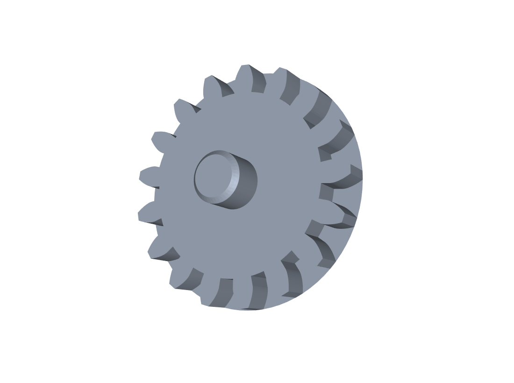
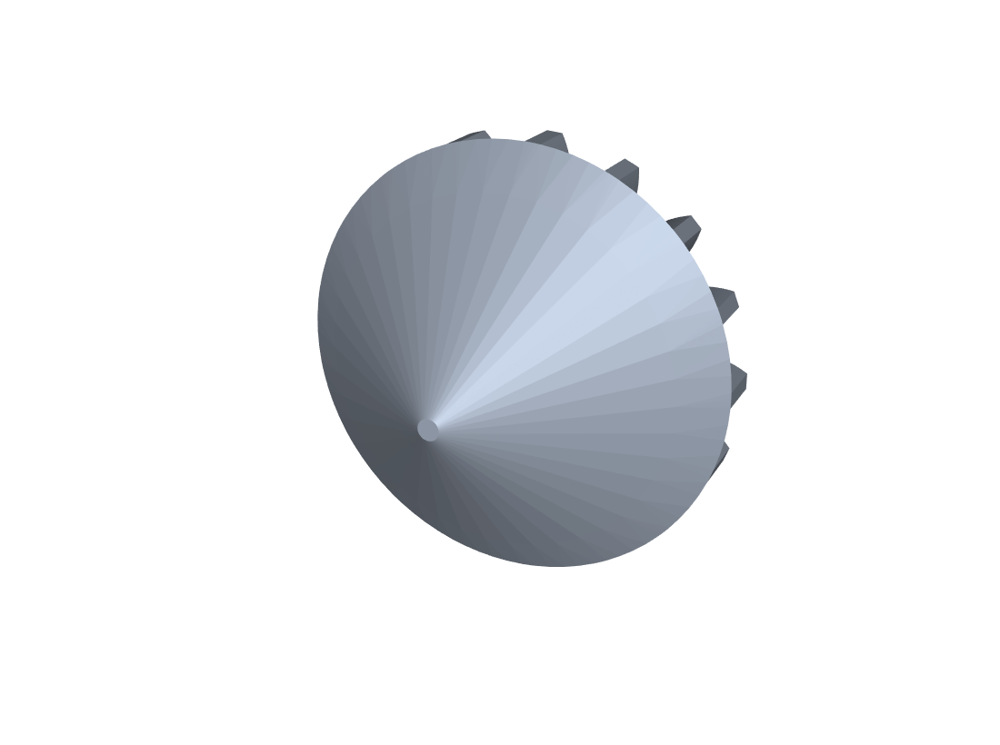
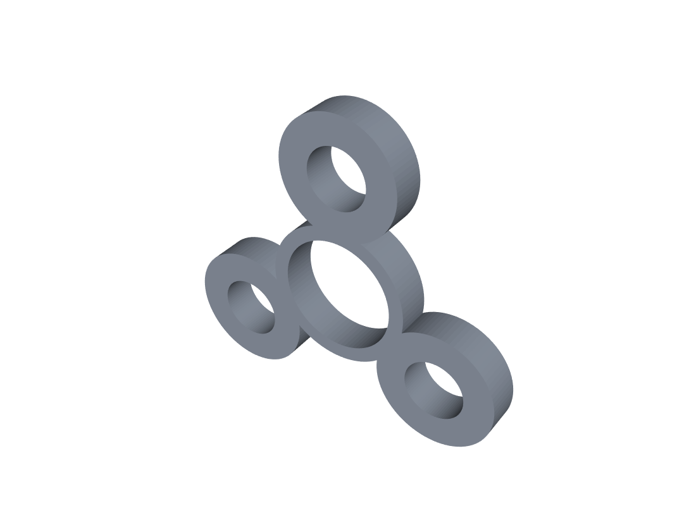
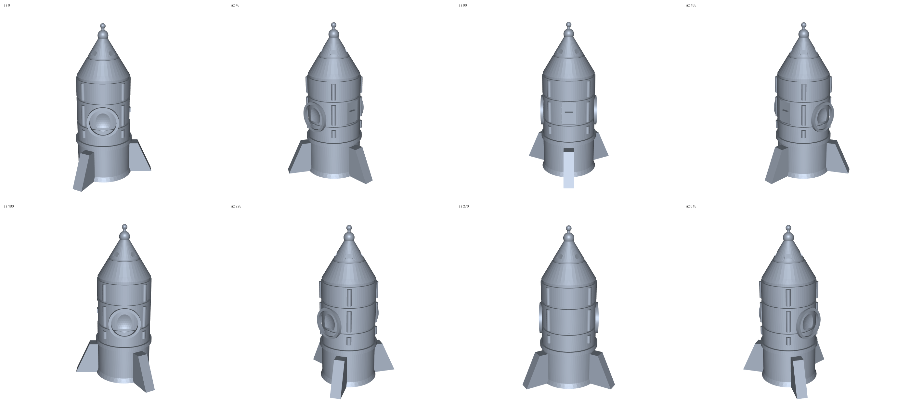
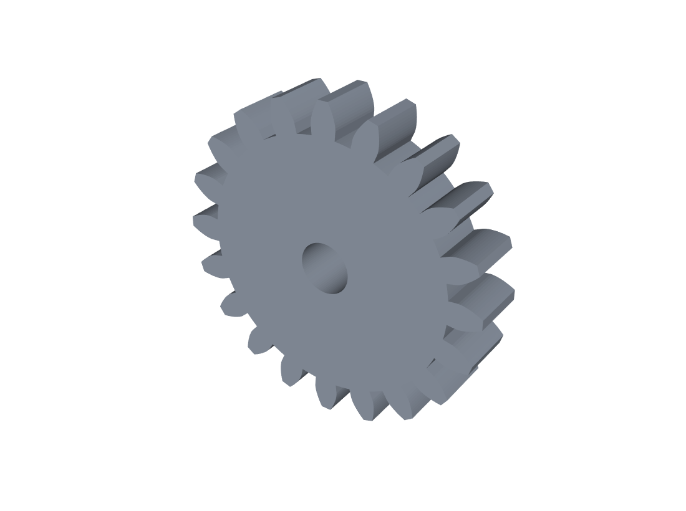

# cad-sample-models

可 3D 打印的小玩具 + 样例零件。所有模型由 CadQuery（OpenCascade 内核）参数化生成。

## 预览

| 齿轮陀螺（顶） | 齿轮陀螺（底 / 锥尖） |
|---|---|
|  |  |

| 指尖陀螺 | 小火箭 v14 |
|---|---|
|  |  |

## 一、3D 打印小玩具（2026-10）

| 文件 | 尺寸 (mm) | 实体体积 | 预估打印\* | 说明 |
|---|---|---|---|---|
| `toys/gear_top.stl` | 38 × 38 × 26 | 10 208 mm³ | ~12 min | 齿轮外缘陀螺，锥尖朝下打印 |
| `toys/fidget_spinner.stl` | 66 × 60 × 7 | 8 445 mm³ | ~13 min | 三叶指尖陀螺，中心 608 轴承孔 Ø22.2 |
| `toys/rocket.stl` | 31.0 × 35.8 × 60.0 | 6 024 mm³ | ~19 min | 战术风中空小火箭，14 个建模阶段 |
| `toys/gear_a.stl` | 44 × 44 × 8 | 9 497 mm³ | ~12 min | 20 齿主动齿轮，m=2，Ø7 轴孔 |
| `toys/gear_b.stl` | 24 × 23 × 8 | 2 074 mm³ | ~4 min | 10 齿从动齿轮，中心距 30 mm |

\* 预估基于 0.4 mm 喷嘴 / 0.2 mm 层高 / 20% 填充 / 约 7 mm³/s 有效挤出速率，实际以切片软件为准。

### 打印建议

- STL 单位是毫米，导入切片软件不要缩放。
- **齿轮陀螺**：锥尖朝下直接打，锥面约 40° 悬垂，一般无需支撑；底面加 3–5 mm brim 更稳。
- **火箭**：竖直打印。内腔从底部喷口贯通到顶部，属内部空心结构，切片时开"检测薄壁"会更保险。
- **齿轮对**：两件分开打，中心距 30 mm 装底板即可啮合。
- **指尖陀螺**：三叶配重孔可塞 M8 螺母，或直接实心打配重。

### 齿轮参数（可复现）

齿廓为标准渐开线（压力角 20°，齿顶高系数 1.0，齿根高系数 1.25）。
生成器 `gearlib.py` 在私有仓库 agentSpace 的 `_cad/scripts/` 下。

## 二、火箭 v14 修复记录（2026-10-30）

上一版（v13）在切片软件里报"空层"和"有个窗子悬空"。逐层扫面 + STL 连通性分析定位到四个真因，全部已修：

| # | 问题 | 真因 | 修法 |
|---|---|---|---|
| 1 | +Y 侧舷窗悬空 | `Workplane("XZ")` 法向是 **−Y**，`extrude(-1.2)` 实际往 +Y 长，+`sy*(r+0.6)` 平移后整圈浮在筒外 0.6 mm | 改成 `extrude(-sy*1.2)` + 平移 `sy*(r-0.6)`，两侧都埋进筒壁 |
| 2 | 舷窗底部 0 壁厚 | 球坑 R8.4 @ y=17.5，最深点正好落在内腔壁（9.1），相切即穿孔 | 改 R7.6 @ y=17.2，最深 9.6，留 0.5 mm 实壁，窗变成盲窗 |
| 3 | 检修槽边缘 0.4 mm 壁 | 槽宽 7.0，在 y=±3.5 处筒面半径 9.9，槽底 9.5，只剩 0.4 mm（≈一条线宽） | 槽宽收到 5.6，边缘保留 0.6 mm |
| 4 | STL 不水密 | OCC 三角化在球头顶点吐了 1 个零面积三角形 → 1 条开边界，切片器据此报空层 | 导出后过一遍 trimesh：删退化面 + 补洞 + 统一法向 |

修复后自检：

- 单实体（solids = 1）、单壳体（shells = 1）、单连通体（bodies = 1）
- `watertight = True`，边界边 0
- 沿 Z 每 0.1 mm 切一层共 600 层，逐层检查闭合轮廓，**异常层 0**

## 三、CATIA 验证零件

| 文件 | 协议 / 格式 | 用途 |
|---|---|---|
| `flange_ap203.step` | STEP AP203 (CONFIG_CONTROL_DESIGN, 1994) | **首选**，兼容性最好 |
| `flange_ap214.step` | STEP AP214 (AUTOMOTIVE_DESIGN, 2000) | 次选 |
| `flange.step` | STEP AP214 | 同上（默认导出） |
| `flange.iges` | IGES 5.3 | 最后兜底 |
| `bushing.step` | STEP AP214 | 第二个零件（轴套） |

零件参数：法兰外径 Ø80 × 厚 12，中心通孔 Ø30，4 × Ø8 均布 PCD 60，外缘 R2；
轴套外径 Ø40 / 内孔 Ø20 × 长 50，两端 1.5 倒角。

校验：`MANIFOLD_SOLID_BREP` 实体、毫米单位、回读 `isValid = true`。

## 四、在 CATIA 里打开

`File > Open` → 选 `.step` → 打开后是 Part 文档 → `File > Save As` → `CATPart`。

**关于 CATPart**：CATPart 是达索私有二进制格式，没有公开规范，无法直接生成；
只能由 CATIA 自己从 STEP/IGES 转存。本仓库提供的就是这个"中转原料"。
