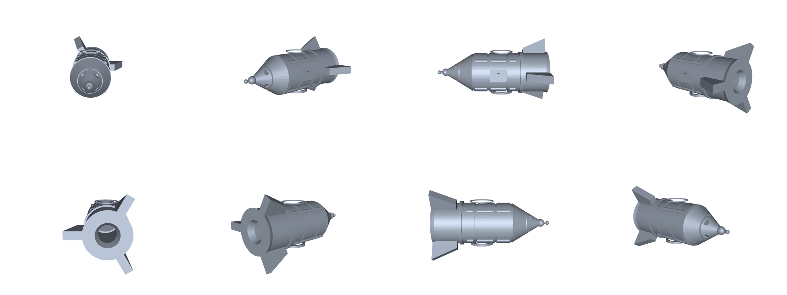
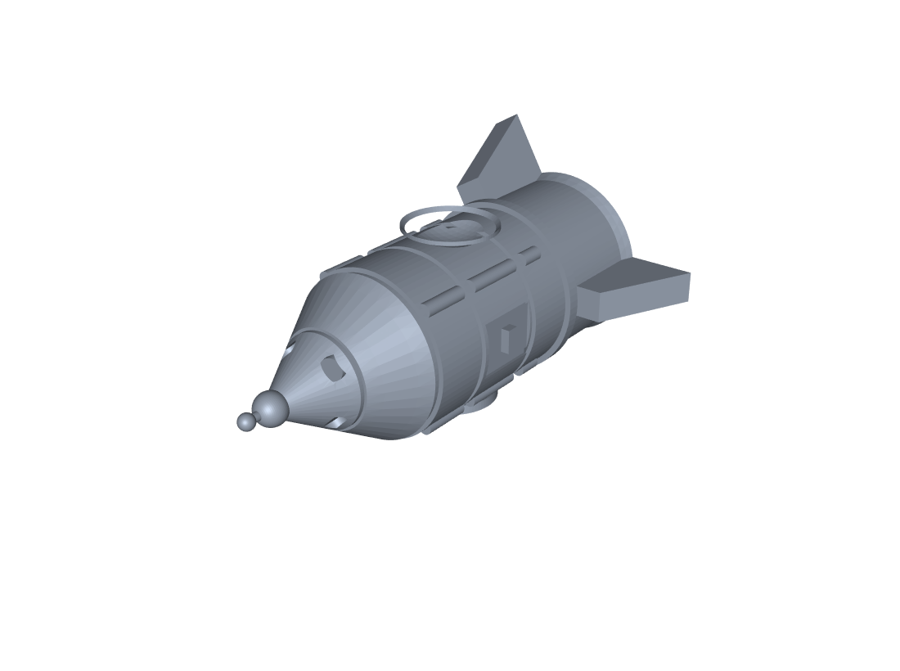
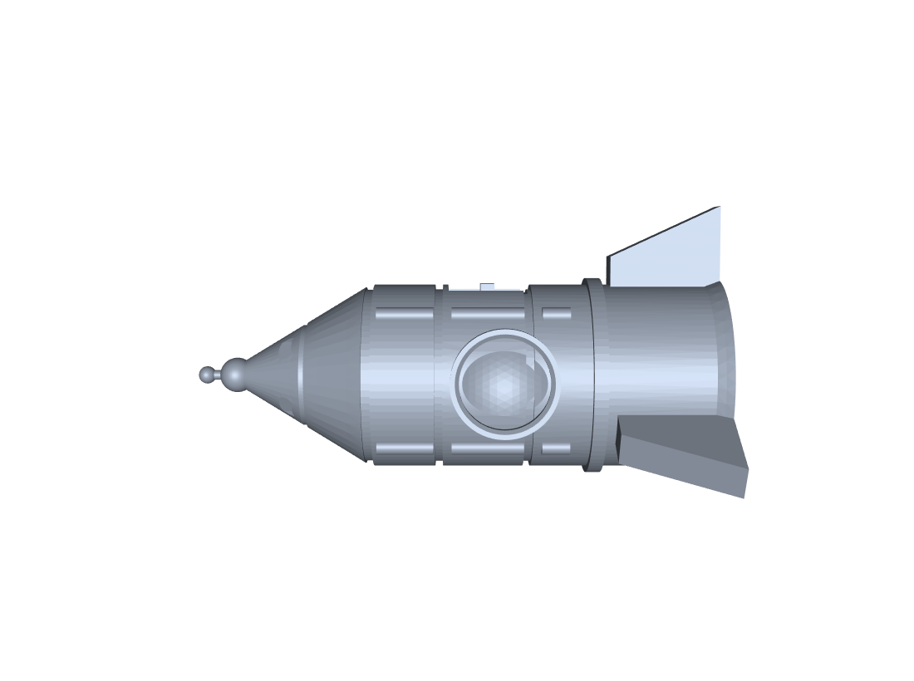
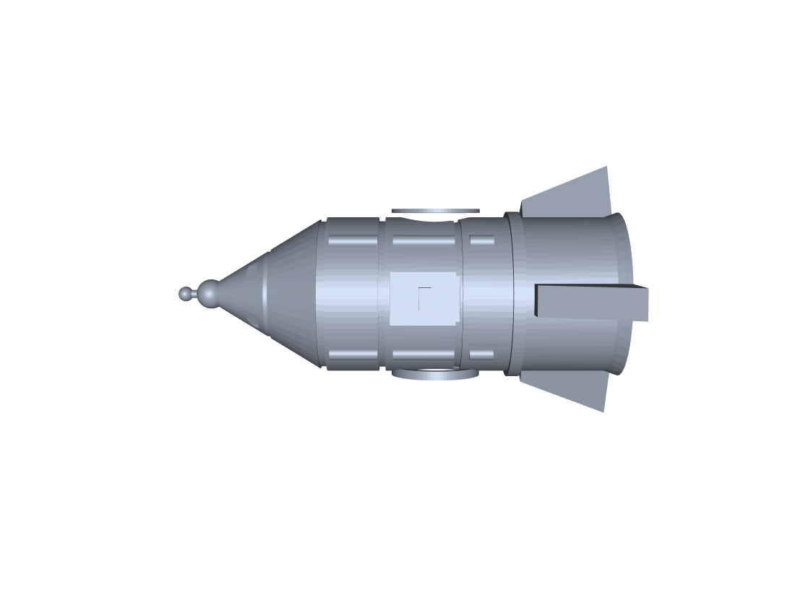

# cad-sample-models — 参数化 CAD 零件 + CATIA 兼容件

用 [CadQuery](https://cadquery.readthedocs.io/)（OpenCascade 内核）参数化建模，导出 **STEP / STL**。
STEP 在 CATIA V5 里 `File > Open` 打开，再 `File > Save As` 即得 **.CATPart**。

> **为什么没有现成的 .CATPart**：CATPart 是达索私有二进制（OLE 复合文档 + 私有几何流），
> 没有公开规范，也没有任何开源写入器。所有 Python/C# 方案（pycatia 等）本质都是
> **驱动本机已安装的 CATIA**，而不是生成文件。所以这份仓库给的是 STEP——CATIA 原生支持，
> 打开后另存一步就是 .CATPart，且带完整实体几何。

---

## 火箭模型 v13（当前版本）

| 八方位 | 斜角 |
|---|---|
|  |  |

| 舷窗正对 | 检修舱口 |
|---|---|
|  |  |

### 规格

| 项 | 值 |
|---|---|
| 外形 | 30.98 × 35.77 × 60.03 mm |
| 体积 | 5 944.7 mm³ |
| 表面积 | 7 746.2 mm² |
| 拓扑 | 118 faces，单实体，`isValid = true` |
| 预估打印 | **18.7 min**（0.2 mm 层高 / 20% 填充 / 7 mm³·s⁻¹） |

### 几何特征

| 部位 | 做法 |
|---|---|
| 箭体 | Ø21 × 40，壁厚 1.4，底部留 3 mm 实心底 |
| 喷口 | 锥形通腔 Ø11.2 → Ø5.2，深 6 |
| 头锥 | 16 高圆锥 + 顶面 Ø1.6，球头 R2.0，顶针 Ø1.1 × 4 + 球 R1.0 |
| 头锥挖空 | 内壁 1.4 等厚跟随锥面 |
| 分界槽 | z = 39.5 ~ 40.5，径向深 0.9 |
| 加强环 | z = 13.6 ~ 15.2，凸出 0.75 |
| 裙摆 | z = 0 ~ 1.8，外扩 0.65 |
| 环槽 | z = 21.6 / 31.6，宽 0.9 |
| 头锥凹环 | z ≈ 47.2，宽 0.8 |
| 纵向加强筋 | 4 条 × 3 段（被环槽自然打断），R0.9，凸 0.5 |
| 检修舱口 | +X 侧 2.4 × 7.0 × 9.0 凹槽 + 槽内把手 |
| 舷窗 | ±Y 双侧，Ø12 唇环 + R8.4 球冠坑，窗心 z = 24.8 |
| 姿控喷口 | 头锥 4 个，径向 Ø2.8 浅坑，45° 分布 |
| 尾翼 | 3 片，厚 2，外伸 9，高 12.5，五段折线带翼尖切角 |

### 14 个建模阶段

`rocket_stages/` 里按顺序打开，就能看到「从一根光筒长成成品」的过程：

| # | 文件 | 体积 mm³ | 做了什么 |
|---|---|---|---|
| 1 | `s1_body.step` | 13 854.4 | 光筒 Ø21 × 40 |
| 2 | `s2_cavity.step` | 4 228.7 | 挖内腔，留 3 mm 底 |
| 3 | `s3_nozzle.step` | 4 005.2 | 锥形喷口通腔 |
| 4 | `s4_nose.step` | 5 020.7 | 加头锥 + 球头 + 挖空 + 顶针 |
| 5 | `s5_seam.step` | 4 987.2 | 切分界槽 |
| 6 | `s6_rib.step` | 5 069.2 | 加加强环 |
| 7 | `s7_skirt.step` | 5 108.6 | 加裙摆 |
| 8 | `s8_rings.step` | 5 041.2 | 两道环槽 + 头锥凹环 |
| 9 | `s9_ribs.step` | 5 106.5 | 4 条纵向加强筋（分三段） |
| 10 | `s10_hatch.step` | 5 063.1 | 检修舱口凹槽 + 把手 |
| 11 | `s11_ports.step` | 5 031.9 | 双侧舷窗（唇环 + 球坑） |
| 12 | `s12_rcs.step` | 5 019.5 | 头锥 4 个姿控喷口 |
| 13 | `s13_probe.step` | 5 024.2 | 顶针 + 球头 |
| 14 | `s14_fins.step` | 5 944.8 | 3 片尾翼 |

> 体积不是单调递增的：切槽、挖窗会减料。第 14 步跳 +920 是加了尾翼。

CATIA 里复现这台的完整手工步骤见 [`docs/rocket_modeling.md`](docs/rocket_modeling.md)。

---

## 其他零件（CATIA 版本兼容验证）

| 文件 | 说明 |
|---|---|
| `flange_ap203.step` | 法兰，AP203（1994 协议），老 CATIA 首选 |
| `flange_ap214.step` | 法兰，AP214（2000 协议） |
| `flange.iges` | 法兰，IGES 5.3 兜底 |
| `flange.png` | 法兰渲染预览 |
| `bushing.step` | 轴套 Ø40 / Ø20 × 50，两端 1.5 倒角 |

法兰：Ø80 × 12，中心孔 Ø30，4 × Ø8 @ PCD60，外缘 R2 → 48 996.87 mm³。
轴套：46 699.78 mm³。

三份格式都含 `MANIFOLD_SOLID_BREP` + `SI_UNIT(.MILLI.,.METRE.)`，即真实体、毫米单位。

---

## 在 CATIA 里打开

1. `File > Open` → 选 `.step` / `.stp` / `.iges`
2. 弹出导入选项时保持默认（CATIA 会自动识别单位）
3. 打开后是 `Part` 里的一个实体，可直接测量、布尔、改模
4. `File > Save As` → 类型选 `CATPart` → 得到 .CATPart

老版本兼容：CATIA V5 从 R7（2001）起内置 STEP 导入，版本基本不是问题；
真正的门槛是 license——STEP 属于 `ST1 - STEP Core Interface`，IGES 属于 `IG1 - IGES Interface`，
教学版一般带，机房完整版更没问题。保险顺序：AP203 → AP214 → IGES。

---

## 用脚本重跑

```powershell
$env:PYTHONPATH='<repo>/_cad/site'
cd <repo>/_cad

# 生成火箭 + 分阶段 STEP
py scripts\toys.py toys rocket

# 渲染单视角（方位角, 俯仰角）
py scripts\render_stl.py toys\rocket.stl toys\v_90.png 90 12

# 拼审视图
py scripts\render_sheet.py toys\v_0.png toys\v_45.png toys\sheet.png
```

---

## 目录

```
.
├── README.md
├── docs/
│   └── rocket_modeling.md      # CATIA 手工复现步骤（14 阶段）
├── scripts/
│   ├── probe.vbs               # CATIA COM API 逐项探测（需装 CATIA）
│   ├── batch_stp2catpart.vbs   # 批量 STEP → CATPart（需装 CATIA）
│   └── make_rocket.vbs         # CATIA COM 建模宏（需装 CATIA）
├── toys/
│   ├── rocket.stl / rocket.step
│   ├── rocket_v13_{sheet,hero,port,hatch}.png
│   └── rocket_stages/s1 ... s14.step
└── flange*.step / flange.iges / bushing.step
```
