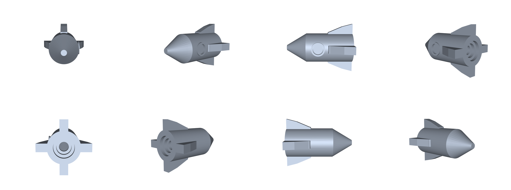
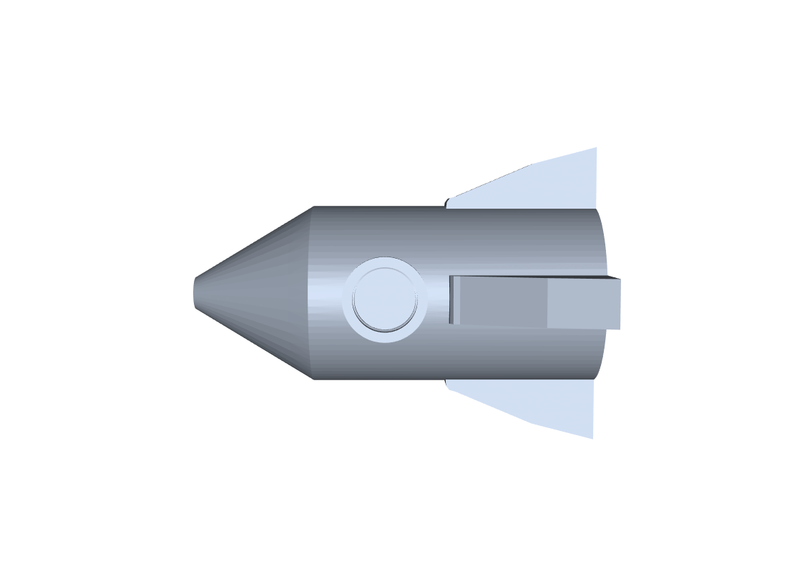

# cad-sample-models

可 3D 打印的小玩具 + 样例零件。所有模型由 CadQuery（OpenCascade 内核）参数化生成。

## 预览

| 齿轮陀螺（顶） | 齿轮陀螺（底 / 锥尖） |
|---|---|
|  |  |

| 指尖陀螺 | 小火箭 v5（八方位） |
|---|---|
|  |  |

| 小火箭 v5（侧视） |
|---|
|  |


## 一、3D 打印小玩具（2026-10）

| 文件 | 尺寸 (mm) | 实体体积 | 预估打印\* | 说明 |
|---|---|---|---|---|
| `toys/gear_top.stl` | 38 × 38 × 26 | 10 208 mm³ | ~12 min | 齿轮外缘陀螺，锥尖朝下打印 |
| `toys/fidget_spinner.stl` | 66 × 60 × 7 | 8 445 mm³ | ~13 min | 三叶指尖陀螺，中心 608 轴承孔 Ø22.2 |
| `toys/rocket.stl` | 36 × 36 × 50 | 7 354 mm³ | ~18 min | 卡通玩具火箭 v5：钝锥头 / 4 片后掠尾翼 / 凸唇舷窗 / 3 段阶梯喷口 |
| `toys/gear_a.stl` | 44 × 44 × 8 | 9 497 mm³ | ~12 min | 20 齿主动齿轮，m=2，Ø7 轴孔 |
| `toys/gear_b.stl` | 24 × 23 × 8 | 2 074 mm³ | ~4 min | 10 齿从动齿轮，中心距 30 mm |

\* 预估基于 0.4 mm 喷嘴 / 0.2 mm 层高 / 20% 填充 / 约 7 mm³/s 有效挤出速率，实际以切片软件为准。

### 打印建议

- STL 单位是毫米，导入切片软件不要缩放。
- **齿轮陀螺**：锥尖朝下直接打，锥面约 40° 悬垂，一般无需支撑；底面加 3–5 mm brim 更稳。
- **火箭 v5**：竖直打印，4 片尾翼落地、底部实心 7 mm 当配重，无需支撑；头锥锥角 68°，悬垂角小于 45° 可直接打。壁厚 1.2 mm = 3 圈 0.4 挤出。
- **齿轮对**：两件分开打，中心距 30 mm 装底板即可啮合。
- **指尖陀螺**：三叶配重孔可塞 M8 螺母，或直接实心打配重。

### 齿轮参数（可复现）

齿廓为标准渐开线（压力角 20°，齿顶高系数 1.0，齿根高系数 1.25）。

生成器 `gearlib.py` 在私有仓库 agentSpace 的 `_cad/scripts/` 下。

## 二、小火箭的「过程文件」

**STEP 里没有草图。** AP203/AP214 只存最终 B-rep 曲面，CATIA 打开是一块哑实体（能测量、能布尔，但没有特征历史）。

想看到“一步步长出来”的过程，这个仓库提供了三样东西：

| 东西 | 能给你什么 |
|---|---|
| `toys/rocket_stages/` | 6 个中间实体，按序号打开就是生长过程 |
| `docs/rocket_modeling.md` | 逐步建模说明（对应 v3 战术风格版） |
| `scripts/make_rocket.vbs` | CATIA V5 宏，跑完得到带特征树、可改尺寸的 CATPart（对应 v3） |

### 分阶段文件（v5）

| 序号 | 文件 | 这一步做了什么 | 体积 |
|---|---|---|---|
| 1 | `s1_body.step` | 箭体外壳 Ø22 × 35 | 13 305 mm³ |
| 2 | `s2_cavity.step` | 挖内腔 Ø19.6，留 7 mm 实心底 | 4 857 mm³ |
| 3 | `s3_nozzle.step` | 开 3 段阶梯喷口 Ø14 → Ø10 → Ø6.5 | 4 226 mm³ |
| 4 | `s4_nose.step` | 加钝头锥（高 15，顶面 Ø4） | 5 497 mm³ |
| 5 | `s5_port.step` | 凸唇舷窗 Ø10 + 浅坑 Ø7.2 深 1.2 | 5 503 mm³ |
| 6 | `s6_fins.step` | 加 4 片后掠尾翼（厚 2.8） | 7 354 mm³ |

体积在第 2、3 步会降，是内腔和喷口切掉的实体——这是正常的。

### v3 版本（历史）

早期做过一版战术风格的火箭（Ø21 × 长 61，双舷窗 / 两道环槽 / 加强环 / 头锥探针 / 3 片尾翼），
对应 `docs/rocket_modeling.md` 和 `scripts/make_rocket.vbs`。
v5 是照实物照片重做的卡通风格，两者不是同一个模型。旧图 `rocket_a.png` / `rocket_side.png` / `rocket_win.png` / `rocket_b.png` 留作对比。

### CATIA 宏

```
cscript //nologo scripts\make_rocket.vbs
```

跑完会在桌面生成 `rocket.CATPart`。宏负责箭体、内腔、喷口、分界槽、加强环、舷窗、1 片尾翼；头锥、尾翼阵列、喷口倒角这三步留手做（旋转体和环形阵列用界面操作比写代码可靠），脚本结束会打印提示。

## 三、CATIA 验证零件

| 文件 | 协议 / 格式 | 用途 |
|---|---|---|
| `flange_ap203.step` | STEP AP203 (CONFIG_CONTROL_DESIGN, 1994) | **首选**，兼容性最好 |
| `flange_ap214.step` | STEP AP214 (AUTOMOTIVE_DESIGN, 2000) | 次选 |
| `flange.step` | STEP AP214 | 同上（默认导出） |
| `flange.iges` | IGES 5.3 | 最后兜底 |
| `bushing.step` | STEP AP214 | 第二个零件（轴套） |

零件参数：法兰外径 Ø80 × 厚 12，中心通孔 Ø30，4 × Ø8 均布 PCD 60，外缘 R2；
轴套外径 Ø40 / 内孔 Ø20 × 长 50，两端 1.5 倒角。

校验：`MANIFOLD_SOLID_BREP` 实体、毫米单位、回读 `isValid = true`。

## 四、在 CATIA 里打开

`File > Open` → 选 `.step` → 打开后是 Part 文档 → `File > Save As` → `CATPart`。

**关于 CATPart**：CATPart 是达索私有二进制格式，没有公开规范，无法直接生成；
只能由 CATIA 自己从 STEP/IGES 转存。本仓库提供的就是这个“中转原料”。
